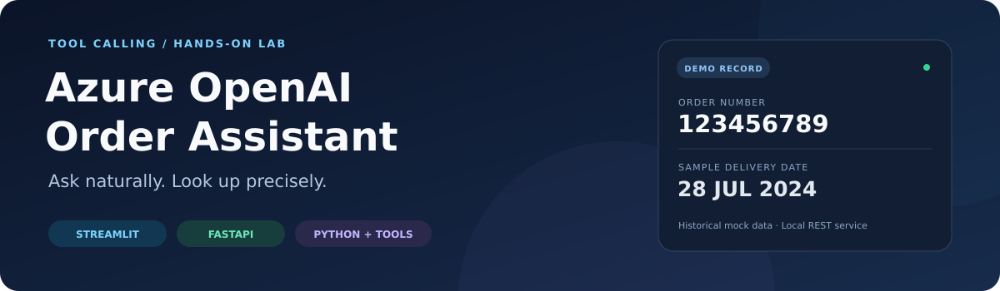
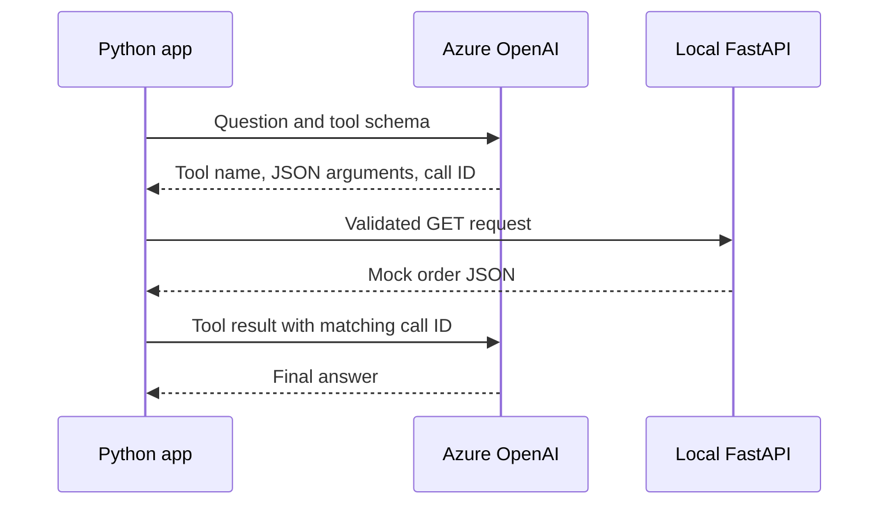

<p align="center">
  
</p>

<p align="center">
  <a href="#quick-start"></a>
  <a href="app.py"></a>
  <a href="GET_JSON.py"></a>
  <a href="tests/test_local.py"></a>
  <a href="https://github.com/KingaTshering10/Azure-openai-order-assistant/commits/main"></a>
</p>

<p align="center">
  <strong>Turn a natural-language question into a validated API lookup.</strong><br>
  Azure OpenAI chooses the tool. Python executes it. The assistant explains the result.
</p>

<p align="center">
  <a href="#quick-start">Quick start</a> ·
  <a href="#try-it">Try it</a> ·
  <a href="#how-it-works">How it works</a> ·
  <a href="#learn-step-by-step">Notebooks</a> ·
  <a href="#verification">Verification</a>
</p>

---

## A small project with the complete tool-calling loop

This learning lab connects a **Streamlit chat app**, an **Azure OpenAI deployment**, and a **local FastAPI order service**. It includes two notebooks and ten local regression checks so you can inspect both the application and its tool-calling protocol.

| 💬 Ask naturally | 🔧 Execute precisely | 🔎 Inspect the evidence |
| --- | --- | --- |
| Ask about delivery, items, or shipping costs. | Validate arguments and call an allowlisted function. | Expand **Tool activity** to see arguments and API results. |

> **Demo scope:** One mock order, **123456789**, with historical 2024 dates. Local checks passed; live Azure completions have not been tested. The API and REST notebook work without Azure credentials.

## Quick start

### 1 · Install and configure

Use **Python 3.11+**. From the repository folder on macOS or Linux:

```bash
python3 -m venv .venv
source .venv/bin/activate
python -m pip install --upgrade pip
python -m pip install -r requirements.txt
cp .env.example .env
```

Edit the root <code>.env</code> with your resource details:

```dotenv
AZURE_OAI_ENDPOINT=https://your-resource.openai.azure.com/
AZURE_OAI_KEY=replace-with-your-key
AZURE_OAI_DEPLOYMENT=your-chat-deployment-name
AZURE_OAI_API_VERSION=2024-10-21
LOCAL_API_URL=http://127.0.0.1:8000/test
```

Use a chat deployment that supports tool calling. **The deployment name can differ from the model name.** Choose an API version supported by your resource. Assistant requests send conversation text and tool results to that deployment and may incur Azure charges.

<details>
<summary><strong>Windows PowerShell setup</strong></summary>

Use these activation and copy commands in place of their macOS/Linux equivalents:

```powershell
.venv\Scripts\Activate.ps1
Copy-Item .env.example .env
```

Use <code>python</code> instead of <code>python3</code> if that is how your Python installation is registered.

</details>

### 2 · Start the order API

In terminal one, with the virtual environment active:

```bash
python GET_JSON.py
```

Open the interactive API explorer at **[127.0.0.1:8000/docs](http://127.0.0.1:8000/docs)**, or test a lookup:

```bash
curl "http://127.0.0.1:8000/test?order_number=123456789"
```

### 3 · Launch the assistant

Open a second terminal in the repository folder, activate the same environment, and run:

```bash
source .venv/bin/activate
streamlit run app.py
```

Open the local address printed by Streamlit. On Windows, use the activation command in the expandable setup section above.

## Try it

| Ask the assistant | Explore |
| --- | --- |
| “When is demo order **123456789** expected to arrive?” | A tool-assisted delivery lookup |
| “What item is in order **123456789**?” | Reading fields from API data |
| “What percentage of the total is shipping for order **123456789**?” | Using a percentage computed by the API |
| “Look up order **999999999**.” | An unknown-order error |
| “Explain what a REST API is in one sentence.” | A direct answer that may need no tool |

Expand **Tool activity** to inspect executed functions and their results. **Clear conversation** resets the session. Successful user/assistant text turns become history for later questions; failed requests do not leave an unmatched stored turn.

<details>
<summary><strong>Peek inside the mock API response</strong></summary>

Selected fields from the sample response:

```json
{
  "DemoData": true,
  "OrderNumber": "123456789",
  "EstimatedDeliveryDate": "2024-07-28",
  "Currency": "USD",
  "OrderValue": 1999.99,
  "ShippingCosts": 15.99,
  "OrderTotal": 2015.98,
  "ShippingPercentageOfTotal": 0.7932
}
```

The shipping share is <code>15.99 / (1999.99 + 15.99) × 100</code>, rounded to four decimal places. Currency, status, totals, and the demo flag are explicit mock fields. The contact address uses <code>example.com</code>.

| Request | Expected response |
| --- | --- |
| <code>/test?order_number=123456789</code> | <code>200</code> · sample order |
| <code>/test?order_number=999999999</code> | <code>404</code> · order not found |
| <code>/test?order_number=abc</code> | <code>422</code> · invalid identifier |
| <code>/test</code> | <code>200</code> · sample order for compatibility with the original exercise |

</details>

## How it works



The model **requests** a function; the Python application **executes** it. The loop also handles a response with no tool call. Open [assistant_core.py](assistant_core.py) to follow the implementation.

<details>
<summary><strong>Explore the execution rules</strong></summary>

- Uses <code>tools</code>, <code>tool_choice</code>, <code>assistant.tool_calls</code>, and <code>role="tool"</code> results with matching <code>tool_call_id</code> values.
- Keeps order identifiers as strings and validates 1–32 digits before making a request.
- Dispatches only registered functions. Unknown tools stop the request.
- Returns structured errors for malformed arguments and expected lookup failures.
- Defaults to two tool-execution rounds, with at most four calls per round; the final permitted model request disables tools.
- Applies a 15-second REST timeout and checks that the API returned the requested order.
- Computes shipping totals and percentages in the API using decimal arithmetic.

Schemas and prompts do not guarantee faithful answers. Compare the answer with the visible tool result.

</details>

## Learn step by step

| Start here | What you will practice |
| --- | --- |
| [01 · REST requests](notebooks/01_rest_requests.ipynb) | Query the local service, inspect JSON and totals, and observe an unknown-order response |
| [02 · Azure tool calling](notebooks/02_azure_tool_calling.ipynb) | Explore function schemas, mock weather, direct answers, API lookups, and tool results |

Open the notebooks in VS Code with the <code>.venv</code> interpreter, or run <code>jupyter lab</code> from the repository root. Run cells from top to bottom. Outputs and execution counts are cleared.

The notebook's weather function returns fixed illustrative values: **72°F ≈ 22.2°C**. It does not fetch live observations and is not exposed by the order-assistant UI.

## Verification

```bash
python -m pip install -r requirements-dev.txt
python -m unittest discover -s tests -v
```

**Ten local checks passed during preparation.** They cover API behavior and arithmetic, argument validation, direct answers, multiple tool calls, unknown orders, bounded execution, SDK message ordering, configuration, and the Streamlit interface. Azure SDK requests used an in-process mock transport. The REST notebook also ran successfully against a local HTTP service.

Both notebooks passed format and Python syntax validation. **No live Azure completion was requested.** The badge above reports the recorded local checks; it is not a CI workflow status. Tested versions and detailed changes are in [review notes](docs/review-notes.md).

## Find your way around

| File | Role |
| --- | --- |
| [app.py](app.py) | Streamlit chat interface |
| [assistant_core.py](assistant_core.py) | Configuration, REST lookup, tool schemas, and execution loop |
| [GET_JSON.py](GET_JSON.py) | Local mock FastAPI service |
| [notebooks/](notebooks/) | Two learning exercises |
| [tests/test_local.py](tests/test_local.py) | Offline regression checks |
| [.env.example](.env.example) | Placeholder configuration |
| [description.txt](description.txt) | GitHub repository description |

<details>
<summary><strong>Troubleshooting</strong></summary>

| Symptom | Check |
| --- | --- |
| Configuration message appears | Fill the root <code>.env</code> with actual values; placeholders are rejected. |
| Order API is unavailable | Keep <code>python GET_JSON.py</code> running and confirm <code>LOCAL_API_URL</code>. |
| Azure request fails | Check endpoint, key, deployment access, supported API version, quota, and connectivity. |
| Order is not found | Only <code>123456789</code> exists in this demo; identifiers must match exactly. |
| The notebook cannot find the project | Start its kernel from inside the repository and select <code>.venv</code>. |

</details>

<details>
<summary><strong>Source, scope, and references</strong></summary>

Prepared from the supplied <code>9API-AzureOpenAI.zip</code> training archive. The credential file, saved notebook outputs, and macOS metadata are excluded. If any original keys are real, rotate them; removing a file does not revoke credentials. Keep your local <code>.env</code> private.

This is a local learning project with one mock order. It includes no real customer authentication, payment processing, shipping integration, or order modification. No model accuracy, latency, or cost benchmark is claimed. A complete authorship or collection-wide license was not supplied, so no blanket license has been assigned to the original training material.

- [Microsoft: Azure OpenAI function calling](https://learn.microsoft.com/en-us/azure/ai-foundry/openai/how-to/function-calling)
- [OpenAI Python SDK](https://github.com/openai/openai-python)
- [FastAPI documentation](https://fastapi.tiangolo.com/)

</details>

<p align="center"><a href="#quick-start">Back to quick start ↑</a></p>
